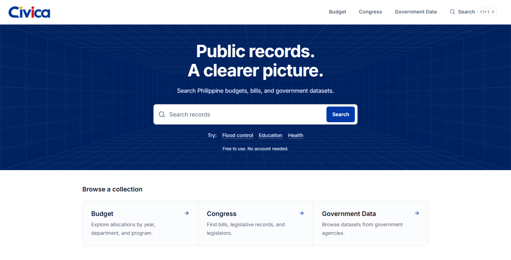

<div align="center">
  <picture>
    <source media="(prefers-color-scheme: dark)" srcset="public/typologo-light.png" />
    
  </picture>

  <h1>CivicLens</h1>
  <p><strong>Public records. A clearer picture.</strong></p>
  <p>Explore Philippine budgets, legislation, and government datasets in one place.</p>

  <p>
    
    
    
    
  </p>

  <p>
    <a href="#features">Features</a> ·
    <a href="#getting-started">Getting started</a> ·
    <a href="#data-sources">Data sources</a> ·
    <a href="https://github.com/eloooong/CivicLens/issues">Report an issue</a>
  </p>
</div>



## Overview

CivicLens, branded as **Civica** in the interface, brings public information from several Philippine data sources into a consistent browsing experience. Search across collections, compare department budgets, follow legislative records, and inspect the sources behind the figures.

The application uses public, read-only data sources. Local setup requires no database, account, API key, or environment file.

> This is an independent demonstration project, not an official government website. Verify figures and records with the original publishing agencies before citing them.

## Features

| Collection | What you can explore |
| --- | --- |
| **Unified search** | Search budget programs, bills, legislators, and datasets, with collection filters and pagination. |
| **Budget explorer** | Browse enacted allocations for FY2020–2026 by department, agency, and program. |
| **Department comparison** | Compare two departments for the same fiscal year, with charts and expense breakdowns. |
| **Proposed budget** | Explore the FY2027 National Expenditure Program against the FY2026 enacted budget. |
| **Budget execution** | Follow available workbook records from proposal through enactment, obligations, and disbursements. |
| **Budget hearings** | Browse House hearing records, topics, timelines, and transcripts with timestamped video links. |
| **Congress** | Find bills and legislators, including source-provided authorship, dates, and document links. |
| **Government data** | Filter datasets by category and publisher, inspect resources, and preview supported files. |
| **Flood control and contractors** | Filter project contracts and contractor summaries when the upstream data file is available. |

The interface includes responsive layouts, shareable filter URLs, keyboard navigation, chart text alternatives, and visible focus states. Overview and source sections start expanded. Motion respects the system's reduced-motion preference, and the hero animation pauses when out of view or when the browser tab is hidden.

## Getting started

### Requirements

- Node.js **20.9 or later**, as required by the installed Next.js version.
- npm and internet access to retrieve public source data.

```bash
git clone https://github.com/eloooong/CivicLens.git
cd CivicLens
npm ci
npm run dev
```

Open [localhost:3000](http://localhost:3000).

### Commands

| Command | Purpose |
| --- | --- |
| `npm run dev` | Start the local development server. |
| `npm run lint` | Run ESLint. |
| `npm run typecheck` | Check TypeScript without emitting files. |
| `npm run build` | Create the production build. |
| `npm start` | Serve the production build. |

## Data sources

| Source | Coverage | API base |
| --- | --- | --- |
| [BetterGov.PH Budget](https://budget.bettergov.ph/docs) | Enacted budgets, proposed budget, execution workbook, and hearings | `https://budget.bettergov.ph/api/v1` |
| [Open Congress](https://open-congress-api.bettergov.ph/api/scalar) | Bills, legislators, and related legislative records | `https://open-congress-api.bettergov.ph/api` |
| [Open Data Portal](https://data.bettergov.ph/docs) | Dataset catalog, publishers, categories, and resources | `https://data.bettergov.ph/api/v1` |

Flood control and contractor views share a separate public JSON feed configured in [`lib/api/floodControl.ts`](lib/api/floodControl.ts). Those views depend on that file remaining available.

### Freshness and provenance

- Core API responses are cached with their actual retrieval timestamps and become eligible for refresh after one hour.
- A failed refresh may leave an older cached response visible with its original timestamp.
- Recorded retrieval times display in Philippine time and are distinct from a publisher's update date. Missing timestamps are labeled unavailable.
- Missing national budget figures display as **Unavailable**, without a fabricated fallback amount.
- Search handles source failures independently so an unavailable collection does not prevent other collections from returning results.

## Architecture

Built with **Next.js App Router**, **React 19**, **TypeScript**, and **Tailwind CSS v4**. Server Components handle data-backed pages; client components provide interactive navigation, charts, and motion.

```text
app/                 Routes, layouts, loading states, and error boundaries
  budget/            Explorer, comparison, proposal, execution, and hearings
  congress/          Bill and legislator browsing and detail pages
  data/              Dataset catalog, resources, contracts, and contractors
  search/            Unified search interface
components/          Shared UI, collection components, charts, and motion
lib/
  api/               Source clients, normalization, and response caching
  search/            Search aggregation and ranking
types/               Source response types and shared record models
public/              Brand assets and static files
```

UI components use the source clients in `lib/api/` rather than fetching directly. Unified search normalizes records into a shared model, retains source ordering, and prioritizes titles that start with the query within each returned page.

## Data limitations

- Coverage and availability depend on upstream sources. An enacted allocation, proposed amount, and disbursement describe different budget stages.
- The Congress integration does not infer bill statuses or legislative progress from filing dates.
- Hearing transcripts, topics, and timelines are machine-generated. Speaker names, summaries, and figures should be checked against the linked video.
- Budget topic search can be capped at 100 programs. The interface discloses the limit and offers department-level browsing.
- Dataset previews support small text resources; other files remain available through source download links.

## Development and deployment

Before submitting a change, run:

```bash
npm run lint
npm run typecheck
npm run build
```

Check affected pages on desktop and mobile, including keyboard controls, reduced motion, and unavailable-source states. Keep source attribution intact and avoid inventing missing data.

Deploy to a host that supports the Next.js server runtime, such as Vercel, or run a production Node.js server:

```bash
npm run build
npm start
```

No application environment variables are required by the current implementation. The host needs network access to the public data sources.

## Acknowledgments and licensing

Data integrations use BetterGov.PH's public services and the agencies credited on individual records. Interface components include adaptations from Bklit UI, Kokonut UI, and React Bits.

The Grid Scan component includes its [upstream MIT + Commons Clause terms](components/reactbits/LICENSE.md). Third-party code and source datasets retain their respective terms. This repository currently does not include a project-wide license.

Maintained by [eloooong](https://github.com/eloooong).
